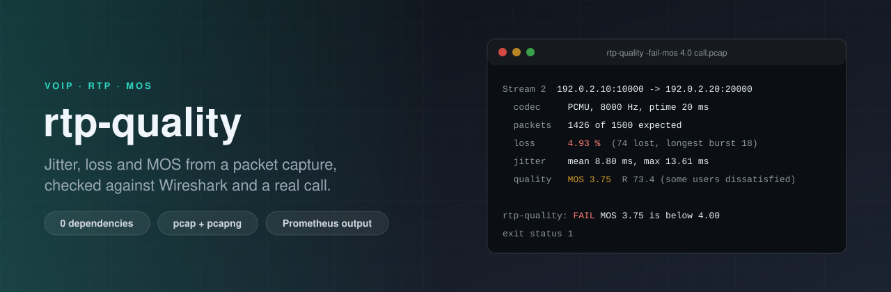

<p align="center">
  
</p>

<p align="center">
  <a href="https://github.com/ErenOzgu/rtp-quality/actions/workflows/ci.yml"></a>
  
  
  
  <a href="LICENSE"></a>
</p>

Give it a capture of a VoIP call and it tells you, for every RTP stream in it, how many packets were lost, duplicated, reordered or too late to play, how much jitter there was, and what that adds up to as an estimated MOS. Output is text for people, JSON for scripts, or Prometheus metrics for a dashboard.

It is a single static binary with **no third-party Go dependencies**. It reads classic pcap and pcapng files (Ethernet, VLAN, Linux "any", loopback, raw IP; IPv4 and IPv6) and does not need Wireshark, a PBX or root.

```text
$ rtp-quality -fail-mos 4.0 call.pcap
call.pcap: pcap, 2926 frames, 2926 UDP datagrams

Stream 1  192.0.2.20:20000 -> 192.0.2.10:10000 ssrc 0x22222222
  codec      PCMU, payload type 0, clock 8000 Hz
  packets    1500 of 1500 expected over 30.0 s, 64.0 kbit/s, ptime 20 ms
  loss       0.00 % on the wire (0 lost), 0.00 % heard (0 arrived too late for a 60 ms buffer)
  order      0 duplicates, 0 out of order
  jitter     mean 0.00 ms, max 0.00 ms; packet spacing mean 20.0 ms, max 20.0 ms
  quality    MOS 4.37, R 91.3 (very satisfied)

Stream 2  192.0.2.10:10000 -> 192.0.2.20:20000 ssrc 0x11111111
  codec      PCMU, payload type 0, clock 8000 Hz
  packets    1426 of 1500 expected over 30.0 s, 60.9 kbit/s, ptime 20 ms
  loss       4.93 % on the wire (74 lost), 4.93 % heard (0 arrived too late for a 60 ms buffer)
  bursts     mean 4.6 packets, longest 18
  order      0 duplicates, 35 out of order
  jitter     mean 8.80 ms, max 13.61 ms; packet spacing mean 21.0 ms, max 378.7 ms
  quality    MOS 3.75, R 73.4 (some users dissatisfied)

rtp-quality: FAIL: 192.0.2.10:10000 -> 192.0.2.20:20000 ssrc 0x11111111: MOS 3.75 is below 4.00
```

The exit status is `1` here, so the same command is a quality gate in a test pipeline.

## Install

```bash
go install github.com/ErenOzgu/rtp-quality/cmd/rtp-quality@latest
```

or take a binary (Linux, macOS, Windows; amd64 and arm64) from the [releases](https://github.com/ErenOzgu/rtp-quality/releases). To build from a checkout: `go build ./cmd/rtp-quality`.

## Use

Record the media on the PBX or the SBC. Only the headers matter, so a short snap length keeps files small:

```bash
tcpdump -i any -s 128 -w calls.pcap 'udp portrange 10000-20000'   # Asterisk's default RTP range
rtp-quality calls.pcap
```

```bash
rtp-quality call.pcapng                         # pcap or pcapng, detected from the file
tcpdump -i any -w - udp | rtp-quality -         # "-" reads stdin
rtp-quality -format json call.pcap | jq '.streams[] | {src, dst, mos, loss_percent}'
rtp-quality -fail-mos 3.8 -fail-loss 3 call.pcap   # CI gate
rtp-quality -pt 96=opus/48000 call.pcap         # describe a dynamic payload type
```

| Flag | Default | |
|---|---|---|
| `-format` | `text` | `text`, `json` or `prometheus` |
| `-o` | stdout | Write the report to a file, replaced atomically (for the node_exporter textfile collector) |
| `-min-packets` | `10` | Leave out streams with fewer packets than this |
| `-fail-mos` | off | Exit 1 if any stream's estimated MOS is below this |
| `-fail-loss` | off | Exit 1 if loss *as heard* (percent, late packets included) is above this |
| `-fail-jitter` | off | Exit 1 if mean jitter (ms) is above this |
| `-playout-delay` | `60` | Jitter buffer (ms) assumed when deciding which packets arrived too late; `0` turns the simulation off |
| `-network-delay` | `0` | One-way network delay (ms) added to the E-model's delay |
| `-pt` | | `PT=name/clockrate` for a dynamic payload type; repeatable |
| `-probation` | `3` | Different sequence numbers a flow needs before it counts as RTP |

Exit status: `0` fine, `1` a threshold was crossed (or a gate was set and no stream was found), `2` usage or I/O error. A stream whose codec has no E-model values is reported as *not checked* by `-fail-mos`, on stderr, rather than passed or failed silently.

### Prometheus

```bash
rtp-quality -format prometheus -o /var/lib/node_exporter/textfile/rtp.prom calls.pcap
```

Every value is a gauge, labelled `src`, `dst`, `ssrc`, `segment` and `codec`: `rtp_stream_mos`, `rtp_stream_r_factor`, `rtp_stream_jitter_seconds`, `rtp_stream_loss_ratio`, `rtp_stream_effective_loss_ratio`, `rtp_stream_lost_packets`, `rtp_stream_late_packets`, `rtp_stream_duplicate_packets`, `rtp_stream_reordered_packets`, `rtp_stream_max_loss_burst_packets`, `rtp_stream_bitrate_bits_per_second`, and a few more. A capture is a finished measurement, which is why none of them are counters. Streams without E-model values simply have no `rtp_stream_mos` series.

### Make a call to test with

`rtp-quality gen` writes a two-way call with exactly the impairments you ask for. The same `-seed` gives the same file, byte for byte.

```bash
rtp-quality gen -o bad.pcap -duration 30 -loss 4 -burst 3 -jitter 25 -reorder 1 -dup 1 -dtmf 3,8 -both
rtp-quality gen -o call.pcapng -format pcapng -nano -codec G729 -loss 2 -jitter 15 -both
rtp-quality gen -o audio.pcap -oneway -codec PCMA -duration 10    # what SIPp's play_pcap_audio plays
```

Loss follows a two-state (Gilbert) model: `-loss` is the long-run rate and `-burst` the average run length, so `-loss 5 -burst 1` is random loss and `-loss 5 -burst 4` is the same amount in clumps. Jitter is a uniform extra delay between 0 and `-jitter` ms.

## How the numbers are made

**Streams.** A stream is one direction of one flow with one SSRC: `(source, destination, SSRC)`. An echoed stream that keeps its SSRC is still two streams. UDP datagrams are accepted as RTP only if they look like it (version 2, not an RTCP packet type) *and* show a flow of at least three different, nearby sequence numbers, in any arrival order; one stray datagram or a repeated packet is not a stream. If a sender restarts its sequence numbers, the stream is split into a second segment instead of being reported as 60 000 lost packets.

**Loss** comes from RFC 3550 extended sequence numbers (appendix A.1, with 16-bit wrap handling): expected is highest minus lowest, lost is expected minus *distinct* packets received. Reordered packets are not loss; duplicates are counted separately and do not hide loss.

**Jitter** is the RFC 3550 section 6.4.1 interarrival jitter, the running estimate `J += (|D| - J) / 16`, in milliseconds on the codec's clock. Packets with the marker bit (the start of a talkspurt after silence suppression) are skipped, and every payload type is timed separately, so DTMF events and comfort noise that share the sequence space do not poison the figure.

**Late packets.** Loss on the wire is not what the listener hears: a packet that arrives after the jitter buffer needed it is as good as lost. The analyzer simulates a fixed buffer (`-playout-delay`, 60 ms) measured from the least-delayed packet seen so far, and counts later ones as discarded. "Heard" loss is lost plus late.

**Bursts.** The average run of consecutive lost packets gives the burst ratio the E-model uses (`BurstR`), because ten losses in a row sound worse than ten spread over a minute.

**MOS** comes from the simplified ITU-T G.107 E-model: `R = 93.2 - Id - Ie,eff`, with the delay impairment `Id` from the Cole-Rosenbluth approximation and `Ie,eff = Ie + (95 - Ie) * Ppl / (Ppl/BurstR + Bpl)`; MOS follows from R with the G.107 Annex B polynomial. The delay is packetisation time + codec look-ahead + playout buffer + `-network-delay`. The codec constants are the published G.113 values, and only these have them, so only these get a MOS:

| Codec | Ie | Bpl |
|---|---|---|
| G.711 (PCMU, PCMA) | 0 | 25.1 |
| G.729 | 11 | 19 |
| GSM full rate | 20 | 10 |
| G.723.1 (6.3 kbit/s) | 15 | 16.1 |

Everything else (G.722, Opus, ...) still gets loss, jitter, bursts and bit rate, plus a line saying why there is no MOS, instead of a number invented for the occasion. A clean G.711 call with 20 ms packets and the default buffer scores R 91.3, MOS 4.37.

## What it does not do

- **It is an estimate, not a listening test.** Nothing here hears the audio. The E-model is for narrow-band codecs and a conversational situation; it knows nothing about echo, background noise or how well a particular decoder hides lost packets beyond the `Bpl` constant. Use the number to compare calls and to notice when quality changes, not as a certificate.
- **Trailing loss is invisible.** Packets lost after the last one that arrived leave no sequence gap.
- **The capture point matters.** Jitter measured where a packet was recorded is the jitter up to that point. A capture on the sender's side says nothing about the network, and a busy capture host adds timestamp noise of its own.
- **Each direction is analyzed alone.** Round-trip time needs RTCP, which is not used here.
- **Not handled:** IP fragments (skipped, and counted), RTP inside TCP or TLS, and anything that is not captured as UDP over IP. SRTP has not been tested; its RTP headers are in the clear and are all that is read, so it should work, but I have not seen it do so.

## How it is checked

- **Against Wireshark.** `hack/crosscheck.py` runs `tshark -z rtp,streams` on the same file and compares packets, lost and mean jitter per stream. CI does this for seven generated calls (clean, random and bursty loss, 45 ms of jitter with reordering and duplicates, DTMF, G.729, pcapng with nanosecond timestamps) and for a real one. They agree on packet counts exactly, on loss to within one packet (tshark counts a duplicate as received, so it hides a loss; the comparison accounts for that), and on mean jitter to within a few tenths of a millisecond.
- **A real call.** `hack/real-call.sh` places a call between two SIPp instances on the loopback interface, plays ten seconds of G.711 into it and has the other side echo it back, records it with `tcpdump`, and checks the result: 500 of 500 packets each way, no loss, sub-millisecond jitter. Then it does it again with the kernel's `netem` on the media ports only (15 ms ± 10 ms delay, 8 % loss) and checks that loss, jitter and a lower MOS show up where they should.
- **Known answers.** The generator is deterministic, so tests compare measured loss, burst length, jitter and duplicate counts to the values that were put in, and the E-model against hand-computed R and MOS values.
- **Hostile input.** Go fuzz tests (20 s each in CI) feed random bytes to the pcap/pcapng readers, the RTP parser and the analyzer; truncated files, absurd lengths, fragments and other protocols are unit-tested.
- Golden files pin the text, JSON and Prometheus output; the Prometheus output is validated against the exposition format's grammar in a test.

## Layout

```
cmd/rtp-quality/     the binary
internal/capture/    pcap and pcapng readers, link layers, IPv4/IPv6/UDP decoding
internal/rtp/        RTP header parser
internal/stream/     sequence tracking, jitter, loss, playout simulation
internal/emodel/     G.107 R factor and MOS
internal/codec/      payload types and E-model constants
internal/report/     text, JSON and Prometheus writers
internal/synth/      deterministic call generator and pcap/pcapng writer
internal/cli/        the command line (and its tests)
hack/                real-call test with SIPp, tcpdump, netem and tshark
```

## License

MIT, see [LICENSE](LICENSE).
